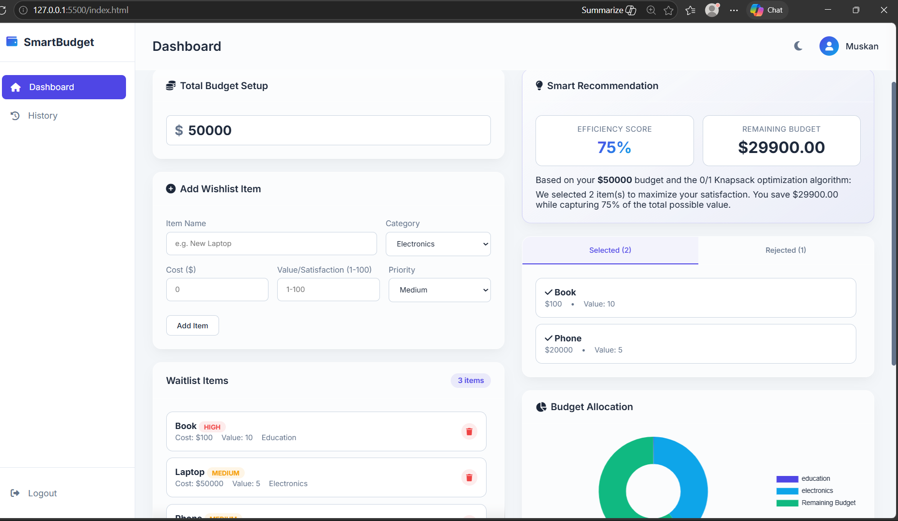

# Smart Budget Planner – Budget Optimization System
## Project Description
Smart Budget Planner is a web-based application that helps users allocate resources efficiently within a fixed budget. The system uses the 0/1 Knapsack Algorithm with Dynamic Programming to select the most valuable items under budget constraints.

## Features
- Budget optimization using Dynamic Programming
- 0/1 Knapsack Algorithm implementation
- Users can input cost, value, and budget
- Real-time optimized item selection
- Responsive user interface.

## Tech Stack
HTML  
CSS  
JavaScript  
Dynamic Programming  
Git & GitHub

## How to Run
1. Clone the repository
(https://github.com/muskankumari23/muskankumari23.github.io.git)

2. Open the project folder

3. Run the project by opening index.html in your browser

## 📸 Screenshots  

  

  

## Author
Muskan Kumari
B.Tech CSE Student
